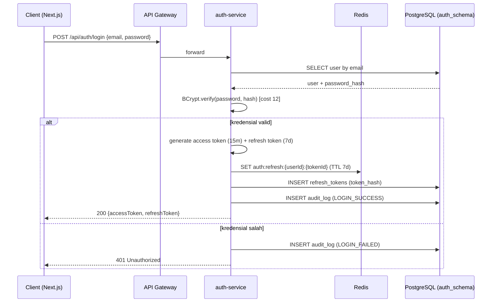
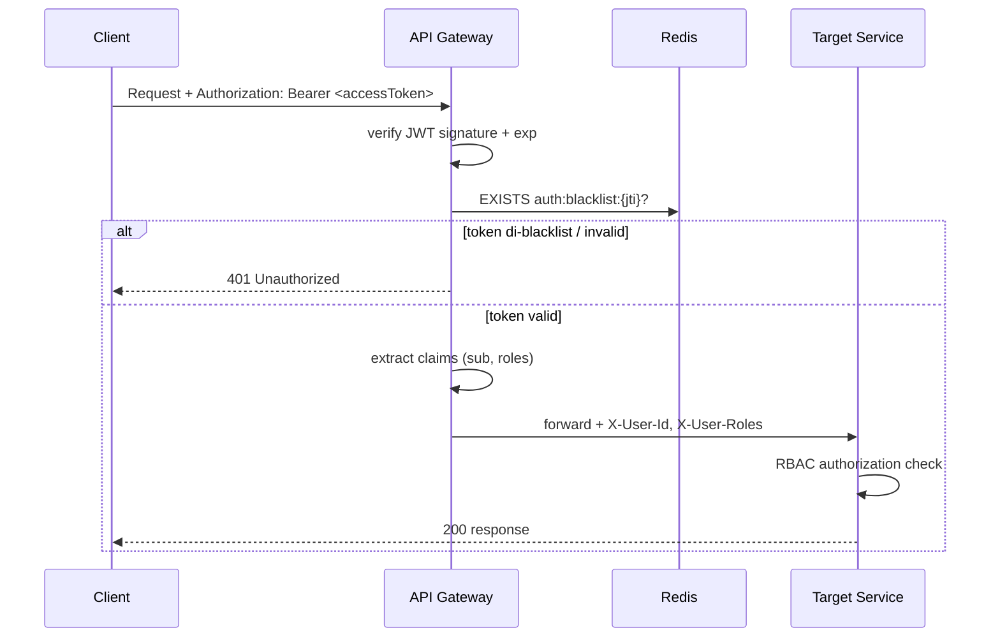
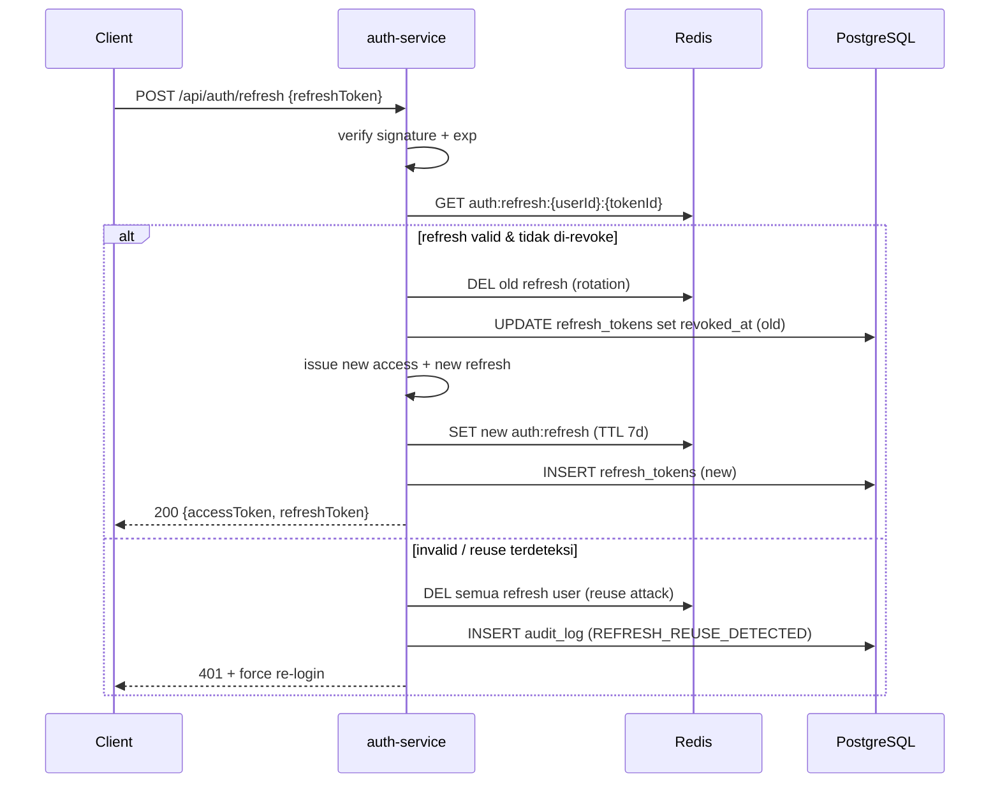
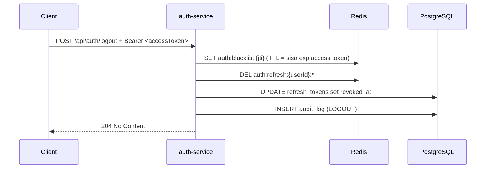
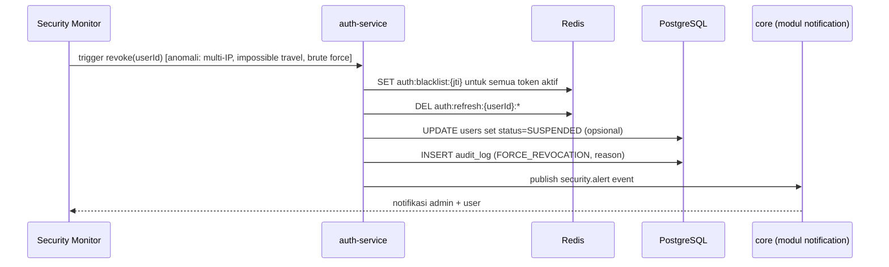
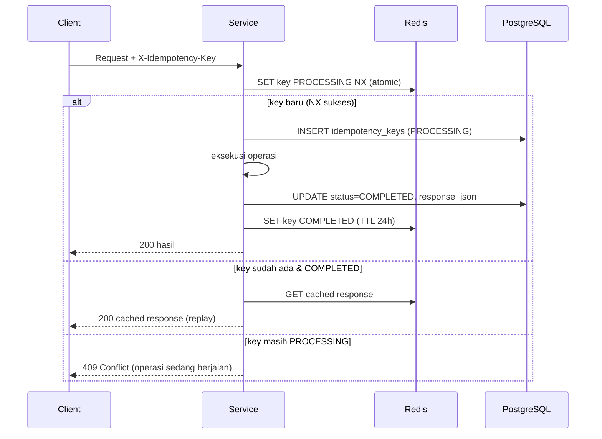

> **Catatan (2026-10-27):** arsitektur kini 4 service. Bagian yang menyebut
> API Gateway/RabbitMQ bersifat historis; lihat ADR-0001 dan security-audit-v2.md.

# Security Architecture
## Platform Koperasi Digital / P2P Lending untuk UMKM Indonesia

| Atribut | Nilai |
|---|---|
| Dokumen | Security Architecture Specification |
| Versi | 1.0 |
| Tanggal | 2026-10-24 |
| Klasifikasi | Confidential / Restricted |
| Kepatuhan | UU PDP No. 27/2022, OJK (LPBBTI), OWASP ASVS 4.0 |

---

## 1. JWT Flow Diagrams

### 1.1 Login Flow


### 1.2 Authenticated Request Flow


### 1.3 Refresh Token Flow


### 1.4 Logout Flow


### 1.5 Token Revocation on Suspicious Activity


---

## 2. RBAC Permission Matrix

Legenda: **C** = Create, **R** = Read, **U** = Update, **D** = Delete, `—` = tidak ada akses, `R*` = hanya data milik sendiri.

| Resource | BORROWER | INVESTOR | REVIEWER | ADMIN |
|---|---|---|---|---|
| **auth** | C R U | C R U | C R U | C R U |
| **borrower-profile** | C R* U* | — | R | R U D |
| **loan-application** | C R* U* (draft) | R | R U | R U D |
| **credit-score** | R* | — | R U (override) | R U D |
| **disbursement** | R* | — | R | C R U D |
| **payment** | C R* | C R* | R | R U D |
| **notification** | R* U* | R* U* | R* U* | C R U D |
| **report** | — | R* (portfolio) | R | C R U D |
| **user-management** | — | — | — | C R U D |
| **system-config** | — | — | — | C R U D |

> Enforcement: Spring Security `@PreAuthorize("hasRole('...')")` + ownership check pada service layer. Prinsip **least privilege** & **deny-by-default**.

---

## 3. Data Encryption Strategy

### 3.1 Field Terenkripsi (Application-Level Encryption)
| Field | Entitas | Alasan |
|---|---|---|
| `nik_encrypted` | borrower_profiles | Data pribadi spesifik (UU PDP) |
| `npwp_encrypted` | borrower_profiles | Data pribadi spesifik |
| `bank_account_encrypted` | borrower_profiles | Data keuangan sensitif |
| `ktp_photo_url` / `selfie_photo_url` | borrower_profiles | Pointer objek terenkripsi (S3 SSE-KMS) |

### 3.2 Algoritma
- **AES-256-GCM** (AEAD): kerahasiaan + integritas (auth tag 128-bit), IV/nonce 96-bit acak unik per operasi.
- Format tersimpan: `base64(IV || ciphertext || authTag)` disertai `key_version`.

### 3.3 Key Management & Derivation
- **Produksi:** AWS KMS sebagai Key Encryption Key (KEK) + **envelope encryption** — Data Encryption Key (DEK) per record/field, DEK dienkripsi oleh KMS.
- **Alternatif on-prem:** master key di vault, DEK diturunkan via **PBKDF2-HMAC-SHA256** (≥ 600.000 iterasi, salt unik).
- DEK plaintext hanya ada di memori, tidak pernah dipersistkan.

### 3.4 Key Rotation
- **KEK:** rotasi otomatis via KMS setiap 90 hari.
- **DEK:** rotasi saat KEK berganti; data lama tetap dapat didekripsi lewat `key_version`.
- **Re-encryption:** job latar belakang bertahap untuk data historis; audit setiap rotasi.
- **Kompromi kunci:** rotasi darurat + re-enkripsi segera + invalidasi versi lama.

---

## 4. Audit Logging Design

### 4.1 Event Categories
- **Authentication:** LOGIN_SUCCESS, LOGIN_FAILED, LOGOUT, REFRESH, FORCE_REVOCATION, PASSWORD_CHANGE.
- **Data Access:** VIEW_SENSITIVE (NIK/NPWP/rekening), DECRYPT_FIELD, EXPORT_REPORT.
- **State Changes:** LOAN_STATUS_CHANGED, PAYMENT_PROCESSED, DISBURSEMENT, SCORE_OVERRIDE.
- **Admin Actions:** USER_CREATED/SUSPENDED, ROLE_ASSIGNED, CONFIG_CHANGED.

### 4.2 Log Entry Format (JSON Structured)
```json
{
  "timestamp": "2026-10-24T08:15:30.123Z",
  "event_id": "uuid-v4",
  "category": "DATA_ACCESS",
  "action": "VIEW_SENSITIVE",
  "actor_id": "user-uuid",
  "actor_role": "REVIEWER",
  "entity_type": "borrower_profiles",
  "entity_id": "profile-uuid",
  "old_value": null,
  "new_value": null,
  "ip_address": "203.0.113.10",
  "user_agent": "Mozilla/5.0 ...",
  "service": "loan-service",
  "correlation_id": "trace-uuid",
  "result": "SUCCESS",
  "prev_hash": "sha256-of-previous-entry",
  "entry_hash": "sha256-of-this-entry"
}
```

### 4.3 Retention Policy
- Retensi **7 tahun** sesuai kewajiban fintech/OJK.
- Hot storage (PostgreSQL `reporting_schema.audit_logs`) 90 hari → arsip dingin (S3 Glacier, immutable/Object Lock) hingga 7 tahun.

### 4.4 Tamper-Evident Mechanism
- **Hash chaining:** `entry_hash = SHA256(prev_hash + canonical(entry))` → setiap perubahan memutus rantai.
- **Append-only:** tabel tanpa UPDATE/DELETE (revoke privilege), S3 Object Lock (WORM).
- Verifikasi integritas periodik + anchoring hash harian ke penyimpanan terpisah.

---

## 5. UU PDP Compliance Map

| Pasal | Ketentuan | Implementasi |
|---|---|---|
| **Pasal 16** | Pemrosesan data pribadi (dasar hukum, persetujuan, tujuan, akurasi) | Persetujuan eksplisit saat registrasi; pencatatan *consent* (timestamp, versi); minimisasi data; tujuan pemrosesan terdokumentasi; hak koreksi via profil |
| **Pasal 20** | Kewajiban keamanan & perlindungan data | AES-256-GCM at-rest, TLS 1.3 in-transit, RBAC least-privilege, audit logging, enkripsi backup, akses data sensitif tercatat & di-*mask* di UI |
| **Pasal 46** | Notifikasi kebocoran data (maks **72 jam**) | Prosedur IR (lihat 5.1): deteksi → triase → notifikasi ke subjek data & Lembaga PDP dalam ≤72 jam, dokumentasi insiden & dampak |

### 5.1 Prosedur Breach Notification 72 Jam
1. **T+0 Deteksi:** alert keamanan/IDS → aktivasi tim IR.
2. **T+ ≤4 jam Triase:** klasifikasi tingkat & ruang lingkup data terdampak; containment.
3. **T+ ≤24 jam Investigasi:** root cause, data subjek terdampak, bukti forensik.
4. **T+ ≤72 jam Notifikasi:** pemberitahuan tertulis ke subjek data & lembaga pengawas PDP berisi jenis data, dampak, dan mitigasi.
5. **Pasca-insiden:** laporan akhir, remediasi, audit, pembaruan kontrol.

---

## 6. Input Validation Strategy (Spring Validation)

Validasi berlapis: **Bean Validation (JSR-380)** di DTO + validasi bisnis di service + parameterized query (anti-SQLi).

```java
public record RegisterRequest(
    @NotBlank @Email @Size(max = 255) String email,
    @NotBlank @Size(min = 12, max = 72)
    @Pattern(regexp = "^(?=.*[a-z])(?=.*[A-Z])(?=.*\\d)(?=.*[@$!%*?&]).+$") String password,
    @NotBlank @Pattern(regexp = "^\\+?62[0-9]{9,13}$") String phone
) {}

public record BorrowerProfileRequest(
    @NotBlank @Pattern(regexp = "^[0-9]{16}$") String nik,
    @Pattern(regexp = "^[0-9]{15,16}$") String npwp,
    @NotBlank @Size(max = 255) String fullName,
    @NotNull @Past LocalDate dateOfBirth,
    @NotNull @Pattern(regexp = "^[MF]$") String gender,
    @NotBlank @Size(max = 500) String address,
    @NotBlank @Size(max = 50) String bankAccount,
    @DecimalMin("0.0") @Digits(integer = 13, fraction = 2) BigDecimal incomeMonthly
) {}

public record LoanApplicationRequest(
    @NotNull Integer loanProductId,
    @NotNull @DecimalMin("100000.0") @Digits(integer = 13, fraction = 2) BigDecimal amount,
    @NotNull @Min(1) @Max(60) Integer tenorMonths,
    @NotBlank @Size(max = 1000) String purpose,
    @NotBlank @Size(max = 100) String idempotencyKey
) {}
```

- Controller memakai `@Valid`; error → `MethodArgumentNotValidException` → HTTP 400 terstruktur (tanpa bocor detail internal).
- Sanitasi output (anti-XSS), whitelist enum, dan normalisasi encoding.

---

## 7. Rate Limiting Rules

Diterapkan di **Nginx** (zona `limit_req`: login 5/m, register 3/m, API 100/m per IP) dan
validasi JWT di setiap service. API Gateway terpisah sudah dihapus (ADR-0001); rate limit
per-user tidak lagi tersedia dan dicatat sebagai trade-off.

| Endpoint | Limit | Scope | Respons saat terlampaui |
|---|---|---|---|
| `POST /api/auth/login` | 5 req/menit | per IP | 429 + `Retry-After` |
| `POST /api/auth/register` | 3 req/menit | per IP | 429 + `Retry-After` |
| `POST /api/loans/apply` | 2 req/menit | per user | 429 + `Retry-After` |
| `/api/payments/**` | 10 req/menit | per user | 429 + `Retry-After` |
| default (global) | 100 req/menit | per IP | 429 |

- Key pattern Redis: `gw:rl:{scope}:{identifier}:{route}` dengan TTL window.
- Login tambahan: lockout progresif setelah kegagalan beruntun + CAPTCHA.

---

## 8. CORS Policy

```yaml
cors:
  allowedOrigins:
    - https://koperasi.example.id
    - https://app.koperasi.example.id
  allowedMethods: [GET, POST, PUT, PATCH, DELETE, OPTIONS]
  allowedHeaders: [Authorization, Content-Type, X-Idempotency-Key, X-Correlation-Id]
  exposedHeaders: [X-Correlation-Id, Retry-After]
  allowCredentials: true
  maxAge: 3600
```

- **Tidak** menggunakan wildcard `*` ketika `allowCredentials: true`.
- Origin diverifikasi ketat; preflight `OPTIONS` di-cache 1 jam.

---

## 9. Security Headers

| Header | Nilai | Tujuan |
|---|---|---|
| `Strict-Transport-Security` | `max-age=63072000; includeSubDomains; preload` | Paksa HTTPS (2 tahun) |
| `X-Frame-Options` | `DENY` | Cegah clickjacking |
| `X-Content-Type-Options` | `nosniff` | Cegah MIME sniffing |
| `Content-Security-Policy` | `default-src 'self'; script-src 'self'; object-src 'none'; frame-ancestors 'none'; base-uri 'self'` | Mitigasi XSS/injeksi |
| `Referrer-Policy` | `strict-origin-when-cross-origin` | Batasi kebocoran referrer |
| `Permissions-Policy` | `geolocation=(), camera=(), microphone=()` | Batasi fitur browser |
| `Cache-Control` | `no-store` (endpoint sensitif) | Cegah caching data sensitif |

---

## 10. Idempotency Key Strategy

### 10.1 Format
```
{service}-{userId}-{action}-{timestamp}-{nonce}
contoh: payment-3f9c-disburse-1730000000-a1b2c3d4
```

### 10.2 Storage
- Tabel `idempotency_keys` (persisten) + cache Redis `pay:idem:{key}` TTL **24 jam**.
- Field: `key`, `service`, `status` (PROCESSING/COMPLETED/FAILED), `response_json`, `created_at`, `expires_at`.

### 10.3 Flow & Conflict Handling


- **Conflict (COMPLETED):** kembalikan **cached response** yang sama → aman untuk retry.
- **Conflict (PROCESSING):** HTTP 409 untuk cegah eksekusi ganda (race condition) — dikombinasikan distributed lock pada operasi finansial.
- Wajib pada: `loans/apply`, `disbursements`, `payments` untuk mencegah dana ganda.
