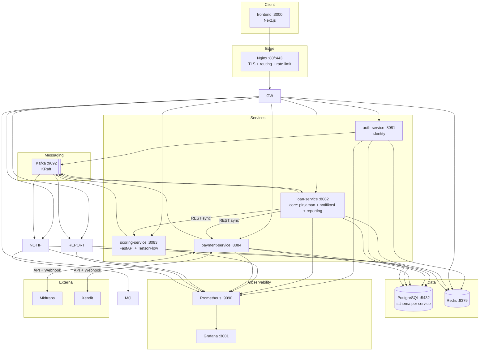

# System Architecture
## Platform Koperasi Digital / P2P Lending untuk UMKM Indonesia

| Atribut | Nilai |
|---|---|
| Dokumen | System Architecture Specification |
| Versi | 1.0 |
| Tanggal | 2026-10-24 |
| Gaya Arsitektur | Microservices, Event-Driven, API Gateway |

---

## 1. Architecture Overview Diagram



---

## 2. Tanggung Jawab per Service

> Arsitektur saat ini adalah **4 service backend** (lihat ADR-0001). Nama historis tetap
> dipakai agar kontrak API dan konfigurasi lama tidak pecah: `loan-service` adalah core,
> `auth-service` adalah identity.

### auth-service — identity (:8081)
- Registrasi, login, logout, dan refresh token (JWT).
- Manajemen pengguna, peran (RBAC), dan penugasan peran.
- Token blacklist & refresh token rotation (via Redis).
- Profil peminjam, enkripsi PII (NIK/NPWP/rekening), penyimpanan KTP/selfie.
- Verifikasi dokumen manual oleh REVIEWER/ADMIN.
- Publikasi event `user.*` ke Kafka (registered, verified, suspended).

### loan-service — core (:8082)
- Orkestrasi siklus hidup pinjaman (state machine) & validasi transisi.
- Manajemen produk pinjaman, aplikasi, cicilan, dan restrukturisasi.
- Memicu scoring (REST sync) dan disbursement (REST sync ke payment).
- Optimistic locking & idempotency pada operasi aplikasi pinjaman.
- **Modul notification:** konsumsi event Kafka, notifikasi persisten, WebSocket/SSE,
  unread count, dan fan-out Redis.
- **Modul reporting:** dashboard, daftar pinjaman, ekspor CSV/PDF melalui datasource
  `report_user` yang read-only.
- Publikasi event `loan.*`, konsumsi `scoring.completed` dan `payment.*`.

### scoring-service (:8083)
- Inferensi AI credit scoring (TensorFlow/Keras) via FastAPI.
- Ekstraksi & transformasi fitur dari payload aplikasi.
- Menghasilkan `score`, `risk_category`, `approval_recommendation`.
- Versioning model & pencatatan explainability (`features_json`).
- Publikasi event `scoring.completed` ke Kafka.

### payment-service (:8084)
- Integrasi Midtrans & Xendit untuk disbursement dan collection.
- Pemrosesan webhook gateway dengan verifikasi tanda tangan.
- Idempotency key & distributed lock (Redis) pada operasi finansial.
- Retry payment berbasis Kafka (`payment.retry`) dan DLT (`payment.retry.DLT`).
- Rekonsiliasi pembayaran/pencairan yang gagal disinkronkan ke core.
- Publikasi event `payment.*` dan `disbursement.*` ke Kafka.

### Nginx (:80/:443)
- Titik masuk tunggal: TLS, routing per path, rate limit per IP, security headers.
- Meneruskan `/ws` ke core dan **memblokir** `/api/v1/loans/internal/**`.
- Tidak lagi memakai API Gateway terpisah.

---

## 3. Communication Patterns

### 3.1 Synchronous REST (service → service)

| Source | Target | Method/Endpoint | Tujuan |
|---|---|---|---|
| Nginx | auth-service | `/api/v1/auth`, `/api/v1/admin/users`, `/api/v1/borrowers` | Routing klien |
| Nginx | loan-service | `/api/v1/loans`, `/api/v1/notifications`, `/api/v1/reports`, `/ws` | Routing klien |
| Nginx | payment-service | `/api/v1/payments` | Routing klien + webhook |
| Nginx | scoring-service | `/api/v1/scoring` | Routing internal/klien |
| loan-service | scoring-service | `POST /score` | Minta penilaian kredit saat `SCORING` |
| loan-service | payment-service | `POST /disbursements` | Inisiasi pencairan saat `APPROVED` |
| payment-service | loan-service | `GET /api/v1/loans/internal/applications/{id}` | Ambil detail pinjaman untuk disbursement |
| payment-service | loan-service | `POST /api/v1/loans/internal/applications/{id}/disbursed` | Callback idempoten setelah webhook pencairan sukses |
| payment-service | loan-service | `POST /api/v1/loans/internal/installments/{id}/paid` | Callback idempoten setelah webhook pembayaran sukses |
| reporting (modul core) | PostgreSQL | query read-only via `report_user` | Agregasi laporan lintas schema |
| frontend | Nginx | REST/HTTPS + WebSocket | Seluruh interaksi klien |

> **Ketahanan callback:** hasil webhook disimpan lebih dulu di `payment_schema`, lalu
> disinkronkan ke core dengan timeout pendek (connect 2 dtk, read 3 dtk). Jika core tidak
> tersedia, baris ditandai `sync_status=FAILED` dan `PaymentReconciliationJob` mengulang
> setiap 5 menit sampai `SYNCED` (idempoten).

### 3.2 Asynchronous Kafka (event → producer → consumer)

| Event (Topic) | Producer | Consumer(s) |
|---|---|---|
| `user.registered` | auth-service | core (notification) |
| `user.verified` | auth-service | core, scoring-service |
| `loan.application.created` | loan-service | scoring-service |
| `loan.application.under_review` | loan-service | core (notification) |
| `loan.application.approved` | loan-service | payment-service, core (notification) |
| `loan.application.rejected` | loan-service | core (notification) |
| `loan.application.disbursed` | loan-service | core (notification) |
| `loan.application.active` | loan-service | core (notification) |
| `loan.application.completed` | loan-service | core (notification) |
| `loan.installment.overdue` | loan-service | core (notification) |
| `loan.defaulted` | loan-service | core (notification) |
| `loan.scoring.requested` | loan-service | scoring-service |
| `loan.scoring.completed` | scoring-service | loan-service |
| `payment.disbursement.*` | payment-service | core (notification) |
| `payment.installment.*` | payment-service | core (notification) |
| `payment.retry` / `payment.retry.DLT` | payment-service | payment-service (retry) |
| `notification.send.requested` | core | core (notification) |

> Retry + DLT (`<topic>.DLT`) aktif di core dan payment-service.

---

## 4. Routing (Nginx / Ingress)

| Path Pattern | Target | Auth Required |
|---|---|---|
| `/api/v1/auth/**`, `/api/v1/admin/users/**`, `/api/v1/borrowers/**` | auth-service :8081 | Partial (login/register publik) |
| `/api/v1/loans/**` | loan-service :8082 | Ya |
| `/api/v1/notifications/**`, `/ws` | loan-service :8082 | Ya (WebSocket: JWT STOMP) |
| `/api/v1/reports/**` | loan-service :8082 | Ya (ADMIN/REVIEWER; export ADMIN) |
| `/api/v1/payments/**` | payment-service :8084 | Ya, kecuali webhook (signature) |
| `/api/v1/scoring/**` | scoring-service :8083 | Ya (internal/REVIEWER) |
| `/api/v1/loans/internal/**` | **404** | Diblokir di edge |

## 5. Database Schema Isolation

Satu instance PostgreSQL (`:5432`), **schema per modul** untuk isolasi logis dengan tetap berbagi instance. Akses lintas-schema dibatasi; modul reporting di core adalah pengecualian read-only yang di-grant `SELECT` terbatas melalui user `report_user`. Data operasional lain dibagikan via API/event.

| Service | Schema | Entitas Utama |
|---|---|---|
| auth-service | `auth_schema` | users, roles, user_roles, refresh_tokens, borrower_profiles |
| loan-service | `loan_schema` | loan_products, loan_applications, loan_installments, loan_restructures, credit_scores (ref) |
| loan-service (modul notification) | `notification_schema` | notifications |
| scoring-service | `scoring_schema` | credit_scores, model_metadata, feature_store |
| payment-service | `payment_schema` | loan_disbursements, payments, webhook_events, idempotency_keys |
| core reporting (read-only) | lintas schema via `report_user` | tidak menulis; query agregasi |
| investor domain* | `investor_schema` | investor_profiles, investment_portfolios, investment_transactions |

> *Domain investor dapat ditempatkan di loan-service atau service terpisah; schema `investor_schema` disediakan untuk isolasi.

**Aturan:**
- Setiap service memiliki kredensial DB & schema terpisah (least privilege).
- Tidak ada JOIN lintas-schema; konsistensi via event-driven (eventual consistency).
- Migrasi schema dikelola per service (mis. Flyway/Liquibase).

---

## 6. Caching Strategy (Redis :6379)

| Use Case | Key Pattern | TTL | Invalidation |
|---|---|---|---|
| JWT token blacklist | `auth:blacklist:{jti}` | = sisa masa token | Auto-expire saat token kedaluwarsa |
| Refresh token store | `auth:refresh:{userId}:{tokenId}` | 7 hari | Hapus saat logout/rotation |
| Session/user profile cache | `auth:user:{userId}` | 15 menit | Evict saat update profil |
| RBAC permission cache | `auth:perms:{userId}` | 10 menit | Evict saat perubahan peran |
| Rate limiting (gateway) | `gw:rl:{ip}:{route}` | window (mis. 60s) | Sliding window auto-expire |
| Loan product catalog | `loan:products:active` | 1 jam | Evict saat produk diubah |
| Loan detail cache | `loan:app:{loanId}` | 5 menit | Evict saat status pinjaman berubah |
| Credit score result | `scoring:result:{loanId}` | 30 menit | Evict saat re-scoring |
| Idempotency guard | `pay:idem:{key}` | 24 jam | Auto-expire |
| Distributed lock (disbursement) | `lock:disburse:{loanId}` | 30 detik | Release setelah operasi/auto-expire |
| Dashboard metrics | `report:dashboard:summary` | 2 menit | Evict/refresh terjadwal |
| Pub/Sub real-time fanout | `notif:channel:{userId}` | n/a | Ephemeral (pub/sub) |

**Prinsip:** cache-aside untuk baca, write-through/evict-on-write untuk konsistensi, dan distributed lock untuk operasi finansial kritikal.

---

## 7. Circuit Breaker Map (Resilience4j)

| Caller | Protected Call | Failure Rate Threshold | Wait Duration (Open) | Fallback |
|---|---|---|---|---|
| loan-service | → scoring-service `/score` | 50% / 10 calls | 30s | Transisi ke `UNDER_REVIEW` manual |
| loan-service | → payment-service `/disbursements` | 50% / 10 calls | 30s | Retry queue + status `PENDING` |
| payment-service | → Midtrans API | 50% / 20 calls | 60s | Failover ke Xendit |
| payment-service | → Xendit API | 50% / 20 calls | 60s | Failover ke Midtrans / mark `FAILED` |
| payment-service | → Kafka publish (`payment.retry`) | 50% / 10 calls | 30s | Simpan status `FAILED`, rekonsiliasi berkala |
| core (notification) | → Redis fan-out | 50% / 10 calls | 30s | Push lokal di instance yang sama |

**Konfigurasi pendukung:** `slowCallRateThreshold` 80% (>2s), `permittedNumberOfCallsInHalfOpenState` 3, dikombinasikan dengan `Retry` (exponential backoff) dan `TimeLimiter`.

---

## 8. Infrastructure Diagram

```mermaid
graph TD
    subgraph Internet
        U[Users / Browser]
    end

    subgraph AWS["AWS Cloud"]
        subgraph K8S["Kubernetes Cluster (EKS)"]
            subgraph IngressNS["ingress"]
                NGINX[Nginx Ingress :80/:443<br/>TLS 1.3 Termination]
            end
            subgraph AppNS["app namespace"]
                AUTHP[auth-service pods]
                LOANP[loan-service / core pods]
                SCOREP[scoring-service pods]
                PAYP[payment-service pods]
                FEP[frontend pods]
            end
            subgraph DataNS["data namespace"]
                KAFKAP[[Kafka (KRaft)]]
                REDISP[(Redis)]
            end
            subgraph ObsNS["observability"]
                PROMP[Prometheus]
                GRAFP[Grafana]
            end
        end
        RDS[(Amazon RDS<br/>PostgreSQL)]
        S3[(S3<br/>Documents/KTP)]
        ECR[(ECR<br/>Container Images)]
    end

    U -->|HTTPS| NGINX
    NGINX --> FEP
    NGINX --> GWP
    GWP --> AUTHP & LOANP & SCOREP & PAYP & NOTIFP & REPORTP
    AUTHP & LOANP & PAYP & NOTIFP & REPORTP --> RDS
    AUTHP & GWP & LOANP & PAYP --> REDISP
    LOANP & PAYP & SCOREP & AUTHP --> KAFKAP
    KAFKAP --> NOTIFP & REPORTP
    NOTIFP --> MQP
    LOANP & PAYP --> S3
    PROMP --> GRAFP
    ECR -.image pull.-> AppNS
```

**Pipeline:** GitHub Actions → build & test → push image ke ECR → deploy ke EKS (Helm/manifest). Secrets via AWS Secrets Manager / K8s Secrets.

---

## 9. Port & URL Reference Table

| Komponen | Port | URL Internal | Keterangan |
|---|---|---|---|
| frontend | 3000 | `http://frontend:3000` | Next.js |
| auth-service (identity) | 8081 | `http://auth-service:8081` | Java 21 |
| loan-service (core) | 8082 | `http://loan-service:8082` | Java 21, termasuk notifikasi & reporting |
| scoring-service | 8083 | `http://scoring-service:8083` | FastAPI + TensorFlow |
| payment-service | 8084 | `http://payment-service:8084` | Java 21 |
| PostgreSQL | 5432 | `postgres:5432` | Schema per modul |
| Redis | 6379 | `redis:6379` | Cache/lock/pubsub |
| Kafka | 9092 | `kafka:9092` | Event streaming (KRaft, tanpa ZooKeeper) |
| Nginx | 80/443 | `https://koperasi.example.id` | Reverse proxy, rate limit, security headers |
| Prometheus | 9090 | `http://prometheus:9090` | Metrics |
| Grafana | 3001 | `http://grafana:3001` | Dashboard |

---

## 10. Horizontal Scaling Notes

| Service | Stateless? | Scalable | Catatan |
|---|---|---|---|
| auth-service | Ya | High | Token/session di Redis, bukan memori lokal. |
| loan-service (core) | Ya | High | State di DB; pastikan idempotency & optimistic locking. |
| scoring-service | Ya | High (GPU-aware) | Inferensi stateless; scale terpisah, pertimbangkan node GPU. |
| payment-service | Ya | Medium | Stateless, tapi operasi finansial butuh distributed lock & idempotency. |
| frontend | Ya | High | Next.js stateless; dapat di-CDN & scale bebas. |

**Prinsip scaling:**
- Semua service aplikasi dirancang **stateless** → state eksternal di PostgreSQL/Redis.
- Gunakan **HPA (Horizontal Pod Autoscaler)** berbasis CPU/RPS/custom metrics (Prometheus Adapter).
- **Modul notification** di core memerlukan penanganan khusus koneksi WebSocket: gunakan Redis Pub/Sub untuk broadcast lintas-replika dan sticky session di ingress.
- **Reporting** berbagi JVM dengan lending; jika beban laporan tumbuh, pisahkan kembali menjadi service tersendiri (jalur keluar sudah disiapkan).
- **Kafka consumer** di-scale via penambahan partisi + consumer group.
- Operasi finansial di **payment-service** harus tetap konsisten via idempotency key + distributed lock meski di-scale.
