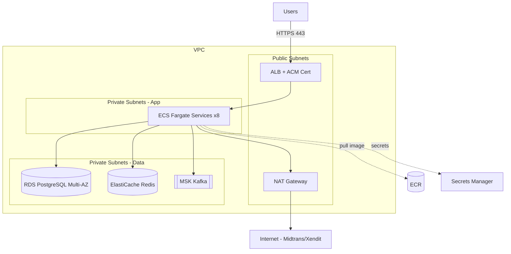

<!-- FILE: docs/deployment/docker-aws.md -->
# Deployment ke AWS (ECS Fargate)
## Platform Koperasi Digital / P2P Lending untuk UMKM Indonesia

| Atribut | Nilai |
|---|---|
| Dokumen | AWS Production Deployment |
| Versi | 1.0 |
| Tanggal | 2026-10-24 |
| Target | AWS ECS Fargate |
| Region | `ap-southeast-1` (Singapore) / `ap-southeast-3` (Jakarta) |

**Arsitektur:** `Internet → ACM/ALB → ECS Fargate Services → RDS PostgreSQL + ElastiCache Redis + MSK Kafka`, secrets via Secrets Manager, image di ECR.



---

## 1. ECR Repository Setup + Push Workflow

```bash
# Buat repository per service
for svc in auth loan scoring payment frontend; do
  aws ecr create-repository --repository-name koperasi/$svc \
    --image-scanning-configuration scanOnPush=true \
    --region ap-southeast-1
done

# Login
aws ecr get-login-password --region ap-southeast-1 \
  | docker login --username AWS --password-stdin <ACCOUNT_ID>.dkr.ecr.ap-southeast-1.amazonaws.com

# Build, tag, push
docker build -t koperasi/loan ./services/loan-service
docker tag koperasi/loan:latest <ACCOUNT_ID>.dkr.ecr.ap-southeast-1.amazonaws.com/koperasi/loan:main-<sha>
docker push <ACCOUNT_ID>.dkr.ecr.ap-southeast-1.amazonaws.com/koperasi/loan:main-<sha>
```

---

## 2. ECS Cluster + Task Definitions

```bash
aws ecs create-cluster --cluster-name koperasi-prod \
  --capacity-providers FARGATE FARGATE_SPOT
```

### Task Definition Sizing (per service)
| Service | CPU | Memory | Desired Count |
|---|---|---|---|
| auth | 512 | 1024 MB | 2 |
| loan | 1024 (1 vCPU) | 2048 MB | 2 |
| scoring | 2048 (2 vCPU) | 4096 MB | 2 |
| payment | 1024 | 2048 MB | 2 |
| notification | 512 | 1024 MB | 2 |
| reporting | 1024 | 2048 MB | 2 |
| frontend | 512 | 1024 MB | 2 |

### Contoh Task Definition (loan-service)
```json
{
  "family": "koperasi-loan",
  "networkMode": "awsvpc",
  "requiresCompatibilities": ["FARGATE"],
  "cpu": "1024",
  "memory": "2048",
  "executionRoleArn": "arn:aws:iam::<ACCOUNT_ID>:role/ecsTaskExecutionRole",
  "taskRoleArn": "arn:aws:iam::<ACCOUNT_ID>:role/koperasiTaskRole",
  "containerDefinitions": [
    {
      "name": "loan",
      "image": "<ACCOUNT_ID>.dkr.ecr.ap-southeast-1.amazonaws.com/koperasi/loan:main-<sha>",
      "portMappings": [{ "containerPort": 8082, "protocol": "tcp" }],
      "environment": [
        { "name": "SPRING_PROFILES_ACTIVE", "value": "prod" },
        { "name": "SERVER_PORT", "value": "8082" },
        { "name": "KAFKA_BOOTSTRAP_SERVERS", "value": "b-1.koperasi.msk.ap-southeast-1.amazonaws.com:9092" }
      ],
      "secrets": [
        { "name": "DB_URL", "valueFrom": "arn:aws:secretsmanager:ap-southeast-1:<ACCOUNT_ID>:secret:koperasi/loan/db-url" },
        { "name": "DB_PASSWORD", "valueFrom": "arn:aws:secretsmanager:ap-southeast-1:<ACCOUNT_ID>:secret:koperasi/loan/db-password" },
        { "name": "JWT_SECRET", "valueFrom": "arn:aws:secretsmanager:ap-southeast-1:<ACCOUNT_ID>:secret:koperasi/common/jwt-secret" }
      ],
      "logConfiguration": {
        "logDriver": "awslogs",
        "options": {
          "awslogs-group": "/ecs/koperasi-loan",
          "awslogs-region": "ap-southeast-1",
          "awslogs-stream-prefix": "loan"
        }
      },
      "healthCheck": {
        "command": ["CMD-SHELL", "curl -f http://localhost:8082/actuator/health || exit 1"],
        "interval": 30, "timeout": 5, "retries": 3, "startPeriod": 60
      }
    }
  ]
}
```

---

## 3. AWS Secrets Manager

```bash
# Simpan secret
aws secretsmanager create-secret --name koperasi/common/jwt-secret \
  --secret-string "base64:xxxxxxxx"
aws secretsmanager create-secret --name koperasi/loan/db-password \
  --secret-string "loanP@ssProd"
aws secretsmanager create-secret --name koperasi/payment/midtrans-server-key \
  --secret-string "Mid-server-xxxx"
```
- **Reference di ECS:** gunakan blok `secrets` pada container definition (lihat §2) dengan `valueFrom` = ARN secret.
- **IAM:** `ecsTaskExecutionRole` perlu permission `secretsmanager:GetSecretValue` + `kms:Decrypt`.
- Aktifkan **rotation** otomatis untuk kredensial DB (Secrets Manager + RDS).

---

## 4. RDS PostgreSQL

| Parameter | Nilai (Production) |
|---|---|
| Engine | PostgreSQL 15 |
| Instance class | `db.r6g.large` (prod) / `db.t4g.medium` (dev) |
| Storage | 100 GB gp3, autoscaling s/d 500 GB |
| **Multi-AZ** | **Enabled** (production) |
| Backup retention | **14 hari** (production), 7 hari (dev) |
| PITR | Enabled |
| Encryption | At-rest (KMS) + TLS in-transit |
| Security Group | Hanya izinkan 5432 dari SG ECS |

```bash
aws rds create-db-instance \
  --db-instance-identifier koperasi-prod \
  --engine postgres --engine-version 15 \
  --db-instance-class db.r6g.large \
  --allocated-storage 100 --storage-type gp3 \
  --multi-az --backup-retention-period 14 \
  --storage-encrypted \
  --vpc-security-group-ids sg-rds \
  --db-subnet-group-name koperasi-db-subnet
```

---

## 5. ElastiCache Redis

| Parameter | Nilai |
|---|---|
| Engine | Redis 7 |
| Cluster mode | **OFF** (primary + 1 replica) |
| Node type | `cache.r6g.large` (prod) / `cache.t4g.micro` (dev) |
| **AUTH token** | Enabled (TLS + requirepass) |
| Encryption | In-transit + at-rest |
| Security Group | Hanya 6379 dari SG ECS |

```bash
aws elasticache create-replication-group \
  --replication-group-id koperasi-redis \
  --replication-group-description "Koperasi Redis" \
  --engine redis --cache-node-type cache.r6g.large \
  --num-cache-clusters 2 \
  --transit-encryption-enabled --auth-token "<strong-token>" \
  --at-rest-encryption-enabled \
  --security-group-ids sg-redis
```

---

## 6. MSK Kafka

| Parameter | Nilai |
|---|---|
| Broker count | **3** (satu per AZ) |
| Instance type | `kafka.m5.large` (prod) / `kafka.t3.small` (dev) |
| Storage | 100 GB per broker |
| Encryption | TLS in-transit + at-rest |
| Auth | IAM / SASL-SCRAM |
| Security Group | 9092/9094 dari SG ECS |

```bash
aws kafka create-cluster \
  --cluster-name koperasi-msk \
  --kafka-version 3.6.0 \
  --number-of-broker-nodes 3 \
  --broker-node-group-info '{"InstanceType":"kafka.m5.large","ClientSubnets":["subnet-a","subnet-b","subnet-c"],"SecurityGroups":["sg-msk"]}'
```

---

## 7. ALB (Application Load Balancer)

- **Listener 443** (HTTPS) dengan sertifikat **ACM**; listener 80 redirect ke 443.
- **Target groups** per service (IP target, protokol HTTP).
- **Path-based routing** di ALB → auth/core/payment/scoring per prefix, `/ws` → core, sisanya frontend.

| Target Group | Port | Health Check Path |
|---|---|---|
| tg-frontend | 3000 | `/` |

```bash
aws acm request-certificate --domain-name "*.koperasi.example.id" --validation-method DNS
aws elbv2 create-load-balancer --name koperasi-alb --type application \
  --subnets subnet-pub-a subnet-pub-b --security-groups sg-alb
```

---

## 8. VPC Setup

| Komponen | Subnet | Akses |
|---|---|---|
| ALB | **Public** subnet (2 AZ) | Internet inbound 443 |
| NAT Gateway | Public subnet | Outbound internet untuk private |
| ECS Fargate | **Private** subnet (2 AZ) | Via NAT untuk Midtrans/Xendit |
| RDS | **Private** subnet (isolated) | Hanya dari ECS |
| ElastiCache | **Private** subnet | Hanya dari ECS |
| MSK | **Private** subnet (3 AZ) | Hanya dari ECS |

CIDR contoh: VPC `10.0.0.0/16`, public `10.0.0.0/24` & `10.0.1.0/24`, private-app `10.0.10.0/24` & `10.0.11.0/24`, private-data `10.0.20.0/24` & `10.0.21.0/24`.

---

## 9. Security Groups (Rules)

| SG | Inbound | Source | Outbound |
|---|---|---|---|
| `sg-alb` | 443, 80 | `0.0.0.0/0` | ke `sg-ecs` |
| `sg-ecs` | 8080–8086, 3000 | `sg-alb` | ke `sg-rds`, `sg-redis`, `sg-msk`, internet (NAT) |
| `sg-rds` | 5432 | `sg-ecs` | — |
| `sg-redis` | 6379 | `sg-ecs` | — |
| `sg-msk` | 9092, 9094 | `sg-ecs` | — |

Prinsip: **least privilege**, referensi antar-SG (bukan CIDR terbuka) untuk traffic internal.

---

## 10. Terraform — Managed Resources

```
terraform/
├── vpc.tf              # VPC, subnets, route tables, IGW, NAT
├── security_groups.tf  # sg-alb, sg-ecs, sg-rds, sg-redis, sg-msk
├── ecr.tf              # 8 repository ECR
├── ecs.tf              # cluster, services, task definitions
├── alb.tf              # ALB, listeners, target groups, ACM
├── rds.tf              # RDS PostgreSQL Multi-AZ + subnet group
├── elasticache.tf      # Redis replication group
├── msk.tf              # MSK cluster
├── secrets.tf          # Secrets Manager entries
├── iam.tf              # ecsTaskExecutionRole, taskRole, policies
├── cloudwatch.tf       # log groups, alarms
└── variables.tf / outputs.tf / providers.tf
```

Daftar resource utama yang dikelola Terraform: `aws_vpc`, `aws_subnet`, `aws_nat_gateway`, `aws_security_group`, `aws_ecr_repository`, `aws_ecs_cluster`, `aws_ecs_service`, `aws_ecs_task_definition`, `aws_lb` + `aws_lb_target_group` + `aws_lb_listener`, `aws_acm_certificate`, `aws_db_instance`, `aws_elasticache_replication_group`, `aws_msk_cluster`, `aws_secretsmanager_secret`, `aws_iam_role`, `aws_cloudwatch_log_group`.

---

## 11. Cost Estimate (perkiraan, USD/bulan)

### Dev (Minimal Setup)
| Komponen | Spesifikasi | Perkiraan |
|---|---|---|
| ECS Fargate | Spot, sedikit task kecil | ~$60 |
| RDS | `db.t4g.medium` Single-AZ | ~$70 |
| ElastiCache | `cache.t4g.micro` | ~$15 |
| MSK | `kafka.t3.small` x1 (atau self-managed) | ~$80 |
| ALB + NAT + lainnya | | ~$55 |
| **Total Dev** | | **~$280/bulan** |

### Production
| Komponen | Spesifikasi | Perkiraan |
|---|---|---|
| ECS Fargate | ~16 task (8 svc x2) | ~$450 |
| RDS | `db.r6g.large` Multi-AZ | ~$500 |
| ElastiCache | `cache.r6g.large` x2 | ~$300 |
| MSK | `kafka.m5.large` x3 | ~$650 |
| ALB + NAT (2 AZ) + data transfer | | ~$180 |
| Secrets/CloudWatch/ECR/S3 | | ~$70 |
| **Total Production** | | **~$2.150/bulan** |

> Estimasi kasar; biaya aktual bergantung traffic, data transfer, dan reserved/savings plan. Gunakan Savings Plan / Reserved Instance untuk menekan biaya RDS & MSK hingga ~30–40%.
