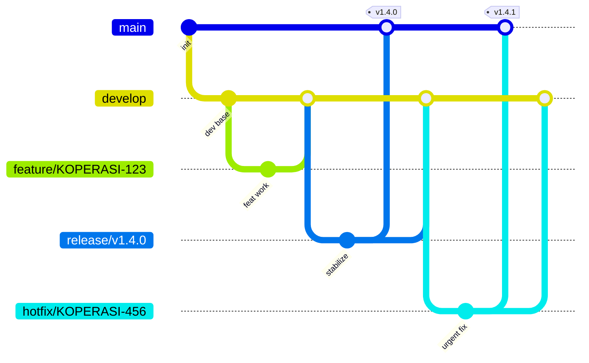

<!-- FILE: docs/development/gitflow.md -->
# GitFlow Workflow
## Platform Koperasi Digital / P2P Lending untuk UMKM Indonesia

| Atribut | Nilai |
|---|---|
| Dokumen | GitFlow Branching Strategy |
| Versi | 1.0 |
| Tanggal | 2026-10-24 |
| Workflow | GitFlow + Agile/Scrum + Conventional Commits |

---

## 1. Branch Types & Naming

| Branch | Peran | Proteksi | Pola Nama |
|---|---|---|---|
| `main` | Produksi; selalu *deployable* | Protected | `main` |
| `develop` | Integrasi fitur | Protected | `develop` |
| `feature/*` | Pengembangan fitur | — | `feature/KOPERASI-{ticketId}-{short-kebab-desc}` |
| `release/*` | Stabilisasi rilis | — | `release/v{major}.{minor}.{patch}` |
| `hotfix/*` | Perbaikan darurat produksi | — | `hotfix/KOPERASI-{ticketId}-{short-desc}` |

**Contoh:**
```
feature/KOPERASI-123-loan-state-machine
release/v1.4.0
hotfix/KOPERASI-456-double-disbursement
```



---

## 2. Merge Rules

| Alur | Mekanisme | Min Reviewer | Syarat |
|---|---|---|---|
| `feature/*` → `develop` | PR | **1** | Semua test pass, CI hijau, coverage threshold |
| `develop` → `release/*` | PR | **2** | Feature freeze, regression test pass |
| `release/*` → `main` | PR + tag | **2** | **Staging verified**, UAT selesai, changelog siap |
| `hotfix/*` → `main` | PR (urgent) | **2 (expedited)** | Fix terverifikasi, test pass |
| `hotfix/*` → `develop` | PR | **1** | Sinkronisasi back-merge wajib |

- Strategi merge: **squash merge** untuk feature → develop (riwayat bersih); **merge commit** untuk release/hotfix → main (jejak rilis).
- **Back-merge wajib:** setelah release/hotfix ke `main`, perubahan di-*merge* balik ke `develop`.

---

## 3. SemVer Versioning & Tag Convention

Format **`v{major}.{minor}.{patch}`** (Semantic Versioning):
- **major** — perubahan breaking (incompatible API).
- **minor** — fitur baru backward-compatible.
- **patch** — perbaikan bug backward-compatible.

| Peristiwa | Contoh Tag |
|---|---|
| Rilis fitur | `v1.4.0` |
| Hotfix | `v1.4.1` |
| Breaking change | `v2.0.0` |
| Pre-release | `v1.5.0-rc.1` |

Tag dibuat pada commit merge di `main`:
```bash
git tag -a v1.4.0 -m "Release v1.4.0: AI scoring + disbursement"
git push origin v1.4.0
```

---

## 4. Protected Branch Rules (`main` & `develop`)

- ❌ **No direct push** — perubahan hanya via PR.
- ✅ Wajib PR approval sesuai jumlah reviewer minimum.
- ✅ Wajib **status check hijau**: build, unit test, integration test, coverage, lint, SAST.
- ✅ Branch harus **up-to-date** dengan target sebelum merge.
- ✅ **Dismiss stale approvals** saat ada commit baru.
- ✅ Wajib **linear history** (no force-push, no deletion).
- ✅ Resolusi semua percakapan review sebelum merge.
- ✅ Signed commits (opsional, direkomendasikan).

---

## 5. Hotfix Workflow (Step by Step)

1. **Deteksi** bug kritikal di produksi; buat ticket `KOPERASI-{id}` prioritas tinggi.
2. **Cabang dari `main`:**
   ```bash
   git checkout main && git pull
   git checkout -b hotfix/KOPERASI-456-double-disbursement
   ```
3. **Perbaiki** + tambahkan test regresi yang mereproduksi bug.
4. **Commit** mengikuti Conventional Commits:
   ```
   fix(payment): prevent double disbursement via idempotency guard
   ```
5. **PR ke `main`** → expedited review (2 reviewer) → CI hijau → merge.
6. **Tag patch** (mis. `v1.4.1`) di `main` → deploy produksi.
7. **Back-merge ke `develop`** (dan ke `release/*` aktif bila ada) agar fix tidak hilang.
8. **Verifikasi** di produksi + tutup ticket + post-mortem bila perlu.

---

## 6. Stale Branch Policy

- **Branch yang sudah di-merge dihapus otomatis setelah 30 hari.**
- Feature branch tanpa aktivitas > 30 hari → ditandai *stale* + notifikasi pemilik; dihapus bila tidak ada respons dalam 7 hari.
- `release/*` dihapus setelah berhasil rilis ke `main` dan back-merge ke `develop`.
- `hotfix/*` dihapus setelah merge ke `main` + `develop`.
- `main` dan `develop` **tidak pernah** dihapus.
- Review housekeeping branch dilakukan tiap akhir sprint.
